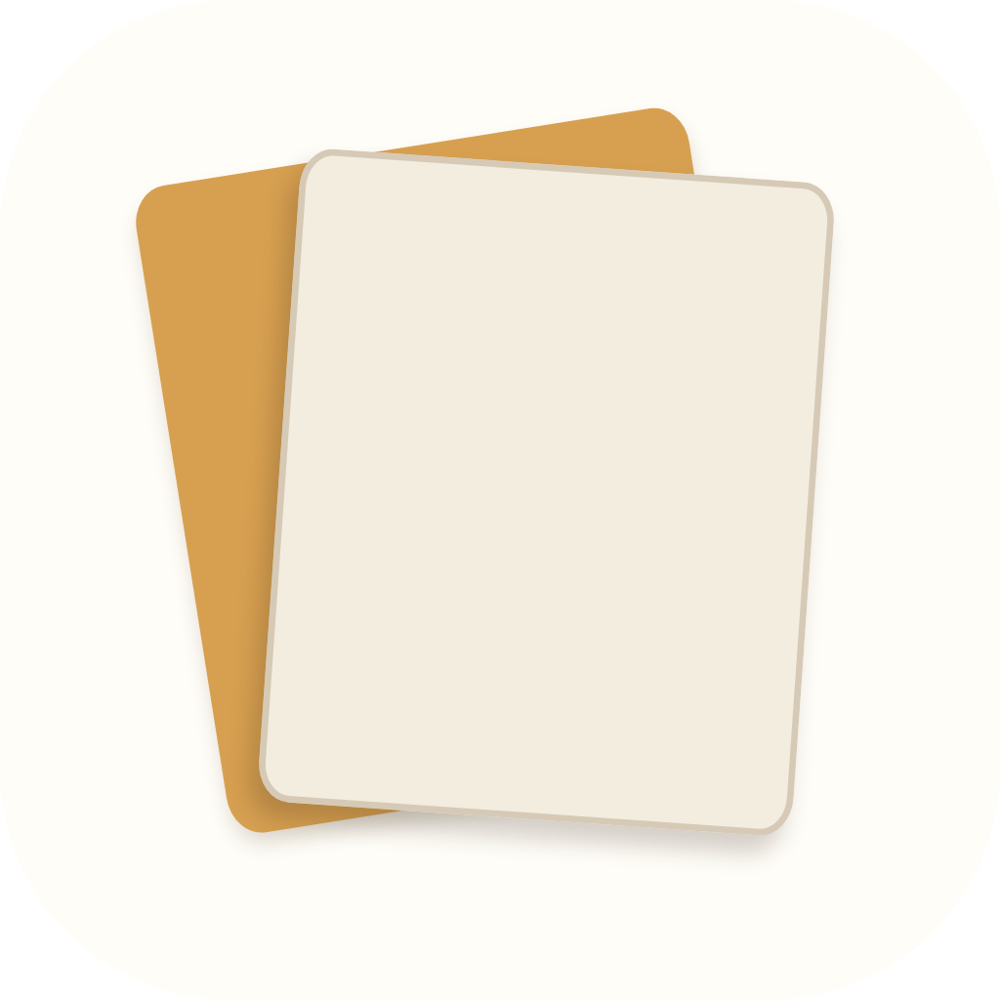

# Loci

A Mac app for learning from what you read, watch and listen to, with one AI companion who lives in your library.

Loci keeps your articles, papers, videos and podcasts in one place and reads them with you. Your companion runs on the agent CLI you already use, or on a bundled Pi with your own model key, remembers what you have read together, and has a personality of its own.

Native Swift, macOS 26 and later. Still in alpha.

## What it does

**Your companion.** One conversation that keeps going, and one beside every item in the library. It answers like a friend messaging you: short replies, an opinion when you ask which one is better. When you finish reading something or save something new, it shows up in the conversation.

**A soul and a memory, as plain files.** Everything that shapes your companion lives in the data folder under `agent/`, readable and editable:

| File | What it holds |
|---|---|
| `SOUL.md` | Your companion’s personality, including a core you can edit, and traits it grows on its own (at most 15) |
| `NAME.txt` | The optional name you give your companion |
| `USER.md` | What it knows about you |
| `MEMORY.md` | What is worth remembering for good |
| `notes/<date>.md` | What happened today, appended by every conversation |
| `diary/<date>.md` | What your companion wrote to itself at the end of the day |

Every night after 23:00, once you have gone quiet, your companion looks back on the day: it writes a diary entry, tidies its memory and may add a trait. Open its profile to name it, change its portrait or read its soul, memory and diary. You can rename it or leave it unnamed.

**Any agent CLI.** Your companion runs on Claude Code, Codex, Pi, Grok, Cursor, OpenCode, Antigravity and others, using the login you already have. Without one, Loci downloads its own Pi and runs on the model service key you enter. Switch the runtime at any time and it is still the same companion. Sessions underneath rotate on their own when the context fills up.

**A library.**

- Articles in a serif reader, papers as PDFs, and a built-in browser for pages that need a login.
- Videos and podcasts transcribed on your Mac with Whisper, with chapters, highlights and a line-by-line translation.
- Highlights anywhere: select a passage, keep a thought, or ask your companion about it right there.

**Following for you.** Connect GitHub, Notion, your calendar, X and the other places you check, and your companion looks on a schedule, putting what it finds into panels beside the conversation. Numbers you only need to see, such as quotes, rates or prices, Loci fetches itself and draws as chart rows, so they never pass through a model. Feeds are filtered by your companion first, and it only wakes when something new arrives.

**Projects.** A long-running thing, like an investment, a trip or a round of interviews, gets its own conversation, panels, schedules and memory, in a bar at the top of the companion page, so it never crowds the main conversation.

**Next up, and a little done for you.** What your companion notices for you lands as a stack of cards on top of the panels: start, keep, later or dismiss. When it wants to put something in your calendar or add a reminder, it shows an approval card first, writes only when you approve, and can take it back. It never pays, orders, signs up or sends messages for you, and never pushes notifications.

**Your other Mac.** Pair two Macs through an end-to-end encrypted relay and switch to the other one's library and companion from the sidebar. What you have opened stays readable offline.

## Build

Requires Xcode 27 or later.

```sh
script/test    # build and test targets affected by local changes
script/run     # build and open Loci (Beta)
```

`script/run --root <folder>` runs against a separate data folder instead of `~/Loci-Beta`.

## Read more

- What is being built, and in what order: [docs/roadmap.md](docs/roadmap.md)
- Why it is built this way: [docs/design.md](docs/design.md)
- What each feature is called and how it should behave: [docs/features.md](docs/features.md)
- How the code is divided: [docs/architecture.md](docs/architecture.md)
- Focused tests and rules for working here: [AGENTS.md](AGENTS.md)

Versions 0.2 to 0.11 were a Tauri app. Its code is kept at the `tauri` tag.

## License

Proprietary. All rights reserved; see [LICENSE](LICENSE) and [NOTICE](NOTICE).
