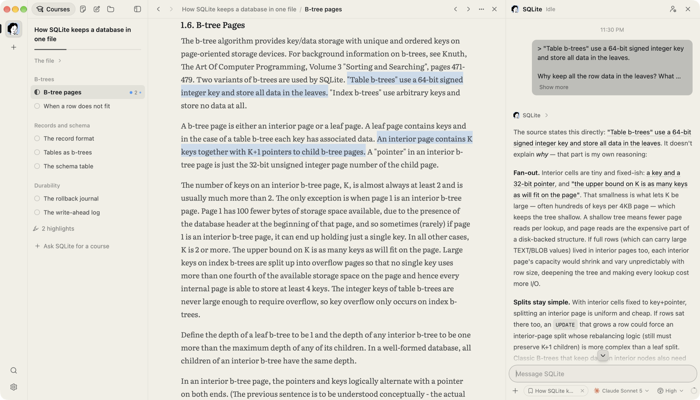
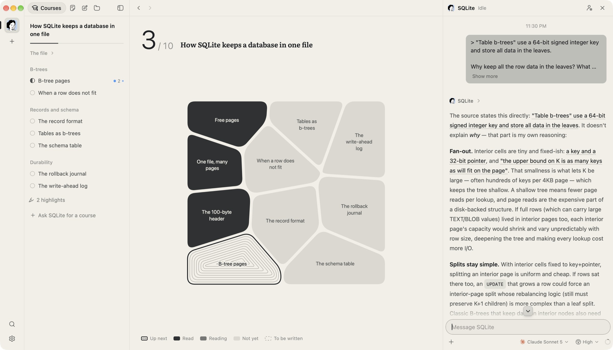

<div align="center">


# Loci

**An AI-native learning workspace for engineers.**

One resident mentor per topic. It gathers the first-hand sources — documentation, specifications, papers, source code — arranges them into a course, and reads them with you.

[**Download for macOS**](https://github.com/Umupa/Loci/releases/latest) · [Linux](https://github.com/Umupa/Loci/releases/latest) · [Changelog](CHANGELOG.md)

[](https://github.com/Umupa/Loci/releases/latest)
[](https://github.com/Umupa/Loci/actions/workflows/ci.yml)
[](LICENSE)

English · [简体中文](README.zh-CN.md)

</div>

<br />



## Learn from the source, with a mentor beside it

Most AI learning tools answer from what the model remembers. Loci starts from the original text. Tell a mentor what you want to learn; it asks what it needs to know, finds the official documentation, the specification, the paper or the repository, and orders the passages worth reading into a short course. You read the original in Loci. Select a sentence and ask, and the answer quotes the passage it rests on.

It runs on the agent CLI you already use — Claude Code or Codex — so there is no API key to add and no account to make. Everything stays on your machine.

## What's inside

**A mentor per topic.** Each mentor is a long-lived agent with its own Soul (how it teaches), memory, library and conversation. Start from **Mentor** for a subject, or **Lens** to understand a repository: it writes a one-page brief in minutes and builds a code tour when you want to go deeper.

**The original, not a summary.** Lessons point at the passage, page or lines to read: a section of a document, pages of a PDF, a function in a repository pinned to the commit it was written against. The code reader has symbols, go-to-definition and references for Go, Rust, C, TypeScript, JavaScript and Python.

**Highlight is the note.** Select text anywhere — a lesson, a PDF, the conversation — and press **H** to highlight or **⌘L** to ask. A highlight takes your thought on it, and every highlight of a course is on one page.

**A course you can see.** With nothing open, the reader shows the course as a map: what you have read in ink, what you are reading in grey, and the next lesson ringed in contour lines.



**In your language.** Mentors write in the learning language you choose (English or 简体中文), and translate the sections your lessons open, side by side with the original.

**From another Mac.** Remote access lets a second computer use this one's workspace — mentors, courses, highlights and all — after pairing with a one-time code.

**A quiet place to read.** Literata and LXGW WenKai for text, JetBrains Mono for code, all built in. Loci Paper and Loci Ink themes, plus 22 Omarchy themes.

## Get started

1. **Download** Loci from [Releases](https://github.com/Umupa/Loci/releases/latest): `.dmg` for macOS (Apple silicon or Intel), `.AppImage` or `.deb` for Linux. Builds are not notarized yet, so macOS asks you to confirm the first time. Loci updates itself after that.
2. **Sign in to an agent CLI.** Install [Claude Code](https://docs.anthropic.com/en/docs/claude-code) or [Codex](https://github.com/openai/codex) and sign in. Loci finds it on your `PATH`.
3. **Create a mentor** with **+** (⌘T), and tell it what you want to learn.

| Keys | |
| --- | --- |
| ⌘T | New mentor |
| ⌘K | Find a mentor, course, source or note |
| ⌘1–9 | Switch mentors |
| H / ⌘L | Highlight / ask about the selection |
| ⌘B / ⌘J | Fold the library / the conversation |
| ⌘[ / ⌘] | Back / forward in the reader |

## Agent CLIs

Loci starts the CLI installed on your machine and speaks its protocol; it does not run models itself. Each CLI keeps its own sign-in, and each mentor picks a model and a permission mode.

| CLI | |
| --- | --- |
| Claude Code, Codex | Supported |
| Antigravity, Pi, Cursor, Grok Build, OpenCode, omp, fx, Hermes Agent | Experimental |

A mentor starts with **Full access** so it can clone repositories and run code without stopping at every step. Change it per mentor, or the default for new mentors, in Settings.

## Your data

- **Files you own.** Each mentor is a folder, `~/Loci/<mentor>/`: sources, courses, notes, Soul and memory as plain files that you and the mentor can both edit. Conversations, progress and highlights are in a local SQLite database. PDFs are never rewritten.
- **No telemetry.** Loci has no analytics or crash reporting. It checks GitHub Releases for updates, and fetches the title and icon of public links in a conversation. Remote access goes through an end-to-end encrypted relay, and only when you turn it on.
- **Agents act as you.** A CLI runs with your user's permissions; the permission mode only decides when Loci asks first.

See [SECURITY.md](SECURITY.md) to report a vulnerability.

## Platforms

| | |
| --- | --- |
| macOS (Apple silicon, Intel) | Primary platform |
| Linux (x64) | Builds and passes the tests; less used day to day |
| Windows | Not built or tried yet |

Loci is young and moves fast; the [changelog](CHANGELOG.md) lists every release.

## Build from source

Node.js 20.19+ or 22.12+, stable Rust, and the [Tauri prerequisites](https://v2.tauri.app/start/prerequisites/) for your platform.

```sh
git clone https://github.com/Umupa/Loci.git
cd Loci
npm ci
npm run app:dev    # Loci Dev, with hot reload
npm run check      # what CI runs: Vitest, tsc, cargo fmt, clippy, cargo test
```

A build from source is **Loci Dev**: a separate app with its own data folder, so it runs beside an installed Loci without touching it. [CONTRIBUTING.md](CONTRIBUTING.md) covers the workflow, [docs/architecture.md](docs/architecture.md) how the pieces fit, and [docs/releasing.md](docs/releasing.md) the release builds.

## Documentation

- [Command line](docs/cli.md): `loci` drives a running Loci from a terminal — mentors, courses, sources, the reader
- [Architecture](docs/architecture.md): processes, agent CLI adapters, storage, trust boundaries
- In Chinese: [reading with your mentor](docs/learning.md), [remote access](docs/remote-deploy.md), [themes](docs/themes.md), [roadmap](docs/roadmap.md)
- [Everything else](docs/README.md)

## License

[MIT](LICENSE). Loci is derived from an earlier MIT-licensed project; [NOTICE](NOTICE) records its origin and trademarks. Loci is independent of the makers of the agent CLIs it runs.
