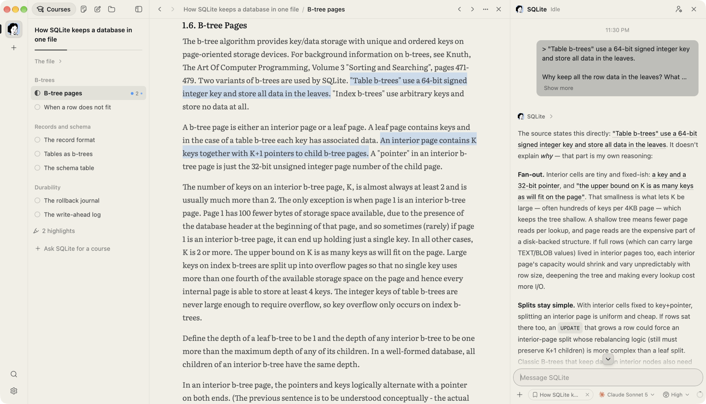
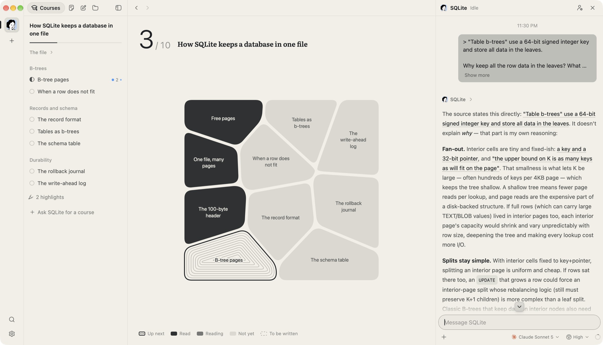

<div align="center">


# Loci

**给工程师的 AI 原生学习工作台。**

一个主题，一位常驻导师。它找来一手材料——文档、规范、论文、源码——排成课程，陪你一起读。

[**下载 macOS 版**](https://github.com/Umupa/Loci/releases/latest) · [Linux](https://github.com/Umupa/Loci/releases/latest) · [更新日志](CHANGELOG.md)

[](https://github.com/Umupa/Loci/releases/latest)
[](https://github.com/Umupa/Loci/actions/workflows/ci.yml)
[](LICENSE)

[English](README.md) · 简体中文

</div>

<br />



## 从原文学，导师就在旁边

多数 AI 学习工具靠模型记得的东西作答。Loci 从原文出发。告诉导师你想学什么，它问清需要知道的，找来官方文档、规范、论文或代码仓库，把值得读的段落排成一门短课。你在 Loci 里读原文，选中一句就能问，回答会引用它依据的那段原文。

它跑在你已经在用的 agent CLI 上——Claude Code 或 Codex——不用配 API key，不用注册账号。所有东西都留在你的电脑上。

## 有什么

**一个主题一位导师。** 每位导师都是长期存在的 agent，有自己的 Soul（怎么教）、记忆、资料库和对话。学一个领域用 **Mentor** 模板；想看懂一个仓库用 **Lens**：几分钟写出一页简报，想深入时再建一门读码课。

**读原文，不是读摘要。** 每一课指向要读的段落、页码或代码行：文档的一节、PDF 的几页、仓库里的一个函数，并钉在写课时的那个 commit 上。代码阅读器支持 Go、Rust、C、TypeScript、JavaScript 和 Python 的符号大纲、跳转定义和查找引用。

**划线即笔记。** 在课文、PDF、对话里选中文字，按 **H** 高亮，按 **⌘L** 提问。高亮上可以写下想法，一门课的所有高亮汇在一页。

**看得见的课程。** 阅读区空着时，课程是一张地图：读完的是墨色，在读的是灰色，下一课围着等高线。



**用你的语言学。** 导师按你选的学习语言（简体中文或 English）写作，并翻译课程要读的章节，原文和译文可以对照着读。

**换一台 Mac 接着学。** 远程访问让另一台电脑用一次性配对码连上这台的工作区，导师、课程、高亮都在。

**安静的阅读。** 正文用 Literata 和霞鹜文楷，代码用 JetBrains Mono，全部内置。有 Loci Paper、Loci Ink 两套纸墨主题，外加 22 套 Omarchy 主题。

## 开始使用

1. **下载**：在 [Releases](https://github.com/Umupa/Loci/releases/latest) 下载 macOS 的 `.dmg`（Apple 芯片或 Intel）或 Linux 的 `.AppImage`、`.deb`。安装包还没有公证，macOS 第一次打开时需要确认。之后 Loci 会自己更新。
2. **登录 agent CLI**：安装 [Claude Code](https://docs.anthropic.com/en/docs/claude-code) 或 [Codex](https://github.com/openai/codex) 并登录，Loci 会在 `PATH` 里找到它。
3. **新建导师**：点 **+**（⌘T），告诉它你想学什么。

| 按键 | |
| --- | --- |
| ⌘T | 新建导师 |
| ⌘K | 查找导师、课程、资料或笔记 |
| ⌘1–9 | 切换导师 |
| H / ⌘L | 高亮选中的文字 / 就它提问 |
| ⌘B / ⇧⌘B | 收起资料库 / 对话 |
| ⌘[ / ⌘] | 阅读区后退 / 前进 |

## Agent CLI

Loci 启动你电脑上安装的 CLI，用它的协议对话，自己不跑模型。每个 CLI 用自己的登录，每位导师各选模型和权限模式。

| CLI | |
| --- | --- |
| Claude Code、Codex | 支持 |
| Antigravity、Pi、Cursor、Grok Build、OpenCode、omp、fx、Hermes Agent | 实验性 |

导师默认 **Full access**，克隆仓库、运行代码时不用每一步都停下来问你。可以在设置里按导师修改，或修改新导师的默认值。

## 你的数据

- **文件归你。** 每位导师是一个文件夹 `~/Loci/<导师>/`：资料、课程、笔记、Soul 和记忆都是普通文件，你和导师都能改。对话、进度和高亮在本地的 SQLite 数据库里。PDF 不会被改写。
- **没有遥测。** Loci 没有统计和崩溃上报。它会向 GitHub Releases 检查更新，并抓取对话里公开链接的标题和图标。远程访问经端到端加密的中继，只在你打开时才启用。
- **agent 以你的身份行事。** CLI 以你的用户权限运行，权限模式只决定 Loci 什么时候先问你。

报告安全漏洞见 [SECURITY.md](SECURITY.md)。

## 平台

| | |
| --- | --- |
| macOS（Apple 芯片、Intel） | 主要平台 |
| Linux（x64） | 能构建、测试通过，日常用得少 |
| Windows | 还没构建和试过 |

Loci 还年轻，迭代很快，每个版本的变化见[更新日志](CHANGELOG.md)。

## 从源码构建

需要 Node.js 20.19+ 或 22.12+、稳定版 Rust，以及对应平台的 [Tauri 依赖](https://v2.tauri.app/start/prerequisites/)。

```sh
git clone https://github.com/Umupa/Loci.git
cd Loci
npm ci
npm run app:dev    # Loci Dev，热重载
npm run check      # CI 跑的检查：Vitest、tsc、cargo fmt、clippy、cargo test
```

源码构建出来的是 **Loci Dev**：一个独立的应用，有自己的数据目录，可以和已安装的 Loci 同时运行、互不影响。工作流程见 [CONTRIBUTING.md](CONTRIBUTING.md)，整体结构见 [docs/architecture.md](docs/architecture.md)，发布构建见 [docs/releasing.md](docs/releasing.md)。

## 文档

- [和导师一起阅读](docs/learning.md)：选中提问、高亮与笔记、阅读位置
- [远程访问](docs/remote-deploy.md)：配对，以及部署自己的中继
- [主题](docs/themes.md)、[路线图](docs/roadmap.md)
- 英文：[命令行](docs/cli.md)（`loci` 在终端里操作运行中的 Loci）、[架构](docs/architecture.md)
- [全部文档](docs/README.md)

## 许可

[MIT](LICENSE)。Loci 派生自一个更早的 MIT 项目，来源和商标见 [NOTICE](NOTICE)。Loci 与它调用的各个 agent CLI 的厂商无关。
