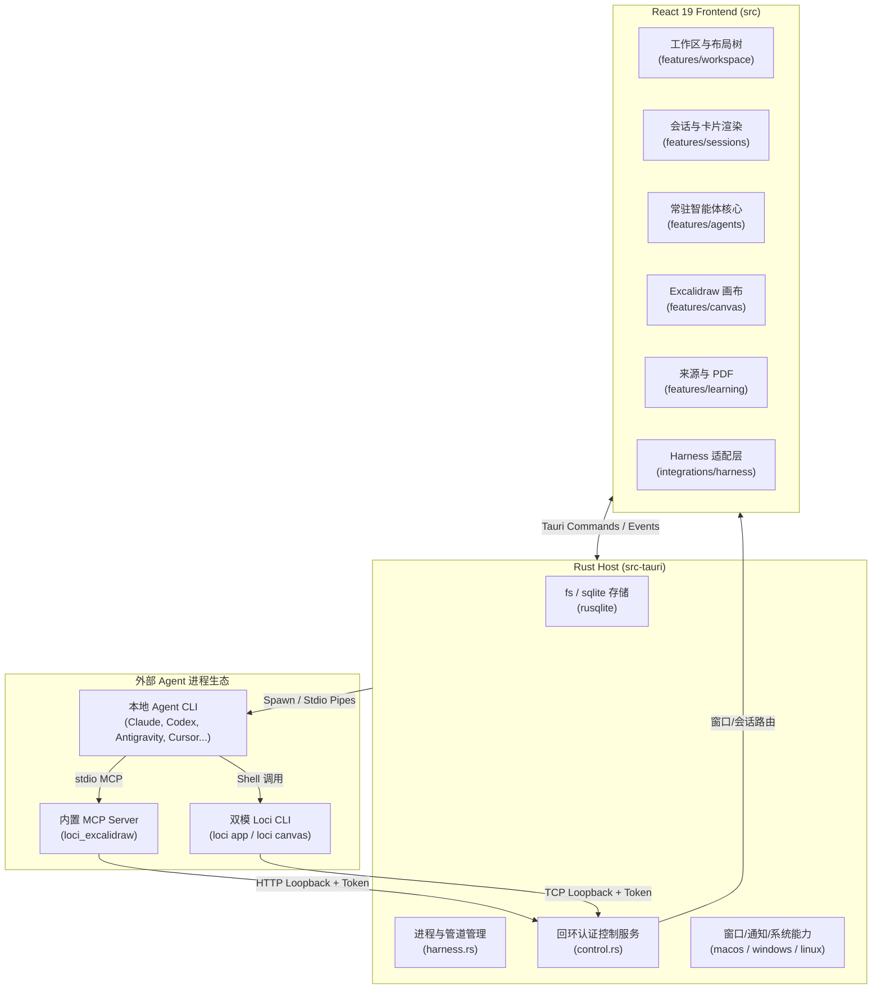
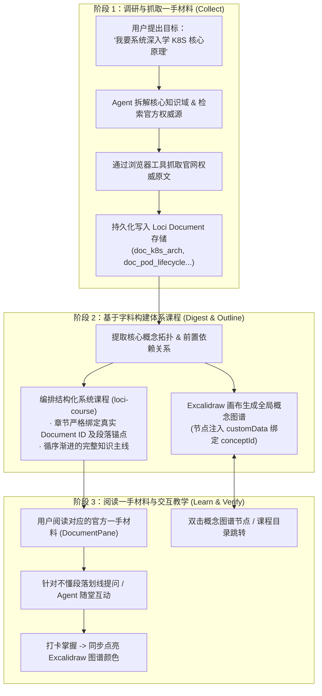

# Loci 教学 Agent 设计讨论全记录

> 本文档记录了关于 Loci 整体架构、现有 Agent（特别是教学 Agent）设计现状，以及基于一手材料（Primary Sources）驱动教学体系重构的完整对话与技术演进共识。

---

## 目录

1. [第一轮对话：当前项目整体架构与设计分析](#第一轮对话loci-当前项目整体架构分析)
2. [第二轮对话：探讨现存 Agent 体系与教学 Agent 形态](#第二轮对话探讨现存-agent-体系与教学-agent-形态)
3. [第三轮对话：教学 Agent 的设计反思与重塑方向](#第三轮对话教学-agent-的设计反思与重塑方向)
4. [第四轮对话：能力边界确认（Agent 抓取 vs Loci 底层原语）](#第四轮对话能力边界确认agent-抓取-vs-loci-底层原语)
5. [结论与后续实施规划](#结论与后续实施规划)

---

## 第一轮对话：Loci 当前项目整体架构分析

### 用户提问
> 分析一下当前项目的设计

---

### Antigravity 回答

本项目（**Loci**）是一个**本地优先（Local-First）的 Agent CLI 桌面外壳（Desktop Shell）**，基于 **Tauri 2 + Rust + React 19 + Tailwind CSS 4 + SQLite** 构建。

它的核心定位是：**不自建云端模型服务，不替用户做中心化托管，而是利用用户本地已安装、已配置好凭据的各类 Agent CLI，为它们提供一个统一、多模态、可反向控制的多分栏桌面工作空间。**



#### 一、 整体系统架构与分层设计

1. **Rust 宿主层 (`src-tauri/src`)**：
   - 负责进程生命周期管理（子进程生成、管道重定向、orphan 进程回收、Windows Job Objects）；
   - 文件系统安全访问受控与本地 SQLite 数据库（`loci.db`，由 `rusqlite` 内置管理）；
   - 系统原生能力封装（macOS 磨砂窗口、交通灯控制、通知中心、系统托盘等）；
   - 认证回环控制服务器（`control.rs`）。
2. **TypeScript / React 前端层 (`src/`)**：
   - 承担几乎全部业务逻辑，包含 10 个 Harness Provider 的协议解析与流式事件转换；
   - 弹性多分栏工作区（Split-Pane Layout & Tabs）；
   - 会话模型（Block / Turn / Card）、Excalidraw 画布渲染、PDF.js 阅读与高亮。

---

#### 二、 核心子系统与关键设计亮点

##### 1. 统一 Harness 适配层（10 大 CLI 协议归一化）
在 `src/integrations/harness` 中统一支持 Claude Code、Codex、Cursor、Grok Build、OpenCode、Pi、omp、fx、Hermes Agent 和 Antigravity：
- **适配器模式**：统一实现 `HarnessAdapter`，将不同协议转换为标准事件流 `HarnessEvent`（如 `message.delta`、`tool.started`、`approval.requested`、`agent.step` 等）；
- **生命周期安全**：注入 `LOCI_HARNESS_PARENT`，在退出时严格收割子进程树；
- **权限模式**：通过前端拦截并响应 CLI 的批准请求（Supervised、Auto-accept edits、Auto、Full access）。

##### 2. 独创的双模二进制与反向控制通道（Loopback Control）
- **双模可执行文件 (`src-tauri/src/main.rs`)**：
  - 正常启动运行 Tauri GUI 桌面应用；
  - 参数为 `loci app ...` 或 `loci canvas ...` 时，秒级切换为轻量 CLI 客户端，直接连接运行中的桌面 GUI。
- **动态授权通道 (`control.rs`)**：
  - 在 turn 启动时生成一次性凭据 `LOCI_APP_ENDPOINT` 和 `LOCI_APP_TOKEN` 注入环境变量；
  - **`app` CLI**：Agent 在当前 turn 内可操作 Loci 界面（启停会话、拆分分栏、读写笔记、检索画布等）；
  - **无侵入 MCP 调用**：不支持配置 MCP 的 CLI（如 Antigravity、Pi）直接在 shell 执行 `loci canvas create_view` 透明调用内置 Excalidraw MCP 服务。

##### 3. 画布与官方 MCP 零侵入协作（Canvas MCP）
- 内置 `loci_excalidraw` 运行未修改的官方 Excalidraw MCP 服务，通过 `loci-bridge.mjs` 拦截并接入 Loci 本地 SQLite；
- 扩展了 `get_elements` 和 `update_elements`，支持按 ID 局部增量修改与版本乐观锁，不破坏用户手工绘制内容。

##### 4. 常驻个人智能体（Personal Agents）
- 持久化 `SOUL.md` 与 `MEMORY.md` 存放在应用数据目录，跨项目共享，换模型不丢失；
- 对话上下文超过 80% 自动轮转新会话并带入摘要，超过 60 轮历史自动沉淀到 SQLite；
- 支持 Habits（后台静默定时运行）与多会话委派追踪。

##### 5. 双沙箱安全学习系统与富卡片渲染
- 代码块即时渲染：`loci-question`（选项表单）、`loci-todo`（可勾选任务清单）、`loci-document`（长文讲义）；
- 基于 PDF.js 实现原生批注高亮与讨论链接绑定，不修改原 PDF 文件。

##### 6. 本地存储架构
全部数据保存在本地 SQLite（`loci.db`）：
- `sessions`, `in_flight_sessions`：会话 Transcript
- `workspace_snapshot`：多分栏树结构快照
- `notes`：Markdown 笔记
- `canvases`, `canvas_checkpoints`：Excalidraw 场景与检查点
- `agent_documents`：Agent 编写的讲义库
- `courses`, `course_progress`：结构化教学课程数据与学习进度记录

---

## 第二轮对话：探讨现存 Agent 体系与教学 Agent 形态

### 用户提问
> 接下来和我一起讨论一下当前的Agent的设计。
> 先看一下目前的设计，特别是教学的Agent，目前的形式是怎么样的？

---

### Antigravity 回答

#### 一、 Agent 体系的架构底座
在 Loci 中，Agent 被设计为**全局常驻智能体（Resident / Personal Agent）**：
1. **状态模型**：
   - `SOUL.md`：核心设定与长效指令；
   - `MEMORY.md` & `memory/<topic>.md`：长期记忆，每次对话动态注入前 200 行；
   - 永久对话流：通过上下文轮转（80% 触发）和分页（60 轮归档）实现长效陪伴。
2. **反向控制**：通过 `loci app ...` 反向修改 Soul、记录 Memory、操作画布、创建笔记、委派子会话。

#### 二、 教学 Agent 的 4 大模板形态

在当时的模板定义中（`agentTemplates.ts`），拆分了 4 种角色：
1. **Tutor (通用导师)**：对话式短轮次教学，解释一个概念立即做练习，开门见山给任务，产出整理到 Library；
2. **Builder (代码构造式导师)**：基于 `build-your-own` 引擎，输出包含步骤完整代码 Diff 的 `loci-course`，配合 `DiffCard` 指引用户从零实现一个系统；
3. **Navigator (领域概念导航导师)**：基于 `domain-navigation` 引擎，在 Excalidraw 生成 20~50 个概念拓扑节点（注入 `customData` 绑定 ID），双击节点跳转课程，打卡后画布节点同步变色（未学灰、学习中黄、掌握绿）；
4. **Lens (快速洞察助手)**：10 分钟单页文档（`loci-document`），快速剖析陌生代码库或文章。

#### 三、 提出的潜在问题思考
1. **一次性全量生成 vs 渐进展开**：一次性输出 20~50 个节点的巨型 Course JSON，易面临模型超时与格式截断；
2. **Chat 会话与 CoursePane 的割裂**：用户注意力到底在聊天还是在工作台；
3. **记忆文本与结构化课程进度的双轨重叠**。

---

## 第三轮对话：教学 Agent 的设计反思与重塑方向

### 用户提问
> 我认为目前的设计有问题，首先是第一个。
> 1、loci-document：这个目前的形式是AI Agent自己写的一个小卡片，但是我期望它是一个真正的我想要学的那个知识的第一手的材料。比如我想学K8S，那这个Document就应该是K8S的官方的文档，是第一手的材料，是需要给用户真正去阅读的一个材料，而不是AI总结自己写的一个材料，这是第一个问题。
> 2、loci-cursor：第二个问题是目前课程的编排。目前整体的教学设计其实是偏向于，因为目前的课程设计都是一个概览。但是我不希望是一个概览，我希望它可以跟我编排一个完整的课程。每一节，我举个例子，比如我要学K8S，那就意味着Agent首先要理解我这个需求，然后获取一手材料，从Vivibrowser抓取一手材料，写入到Document，基于Document来编排我的课程。本质上是基于这个Skill的思想，你可以去研究一下这个Skill。
> https://github.com/tw93/Waza/blob/main/skills/learn/SKILL.md
> 
> 这样子的话才能让我去真正的读到一手材料，而不是经过AI去各种总结的。我的需求就是我需要读到真正的一手材料，并且有更完整的课程，而不是只是一个概览卡片。
> 
> 还有一个是目前把课程设计分成了三个不同的角色，我们先专注第三个吧，就是这个。Navigator 我认为本质上只是需要在提示词上去控制三种不同的角色。Loci应该是提供一种底层的工具调用和UI组件。

---

### Antigravity 回答

这个反思一针见血地点破了此前设计的根本痛点：**此前实现把重心放在了“让 AI 表现得很全能（写总结卡片、编步骤概览）”，却恰恰丢掉了学习最重要的基础——真实的权威一手材料（Primary Sources）与用户自身的认知沉淀。**

这完美契合 [Waza `learn`](https://github.com/tw93/Waza/blob/main/skills/learn/SKILL.md) 的核心契约：
- *“Support the user's thinking; do not replace it.”*（辅助思考，而非替代思考）
- *“Gather primary sources only: papers, official blogs, canonical repos. Not summaries. Not explainers.”*（只收集一手材料，拒绝 AI 二手总结与转述）
- *“Digest means building the mental model. Summarizing is not digesting.”*（消化是构建心智模型，总结不是消化）



#### 核心调整方案

##### 1. 重新定义 `loci-document`：从“AI 二创卡片”回归“一手权威材料库”
- 不再是 LLM 生成的一两百字总结；
- 沉淀为完整的官方一手文档、标准规范或源码实现；
- 用户在 Loci 中进行原汁原味的沉浸长文阅读，支持大纲目录、长文滚动、高亮批注与划线提问。

##### 2. 课程体系编排：锚定字料（Grounded in Sources）
- 课程章节不再悬空，每个概念节点（Concept）显式绑定一手材料：
  ```json
  {
    "id": "pod-lifecycle",
    "title": "Pod Lifecycle & Phases",
    "documentId": "k8s-pod-lifecycle-official",
    "section": "Pod status and phase transitions",
    "sourceUrl": "https://kubernetes.io/docs/concepts/workloads/pods/pod-lifecycle/",
    "explanation": "Agent 提供的导读提示与思考题",
    "prerequisites": ["container-basics"],
    "leadsTo": ["pod-readiness-probe"]
  }
  ```
- 界面联动：点击课程章节或双击 Excalidraw 概念图，侧边工作区分栏直接展开对应的官方一手材料原文！

##### 3. 角色体系解耦：Loci 提供底层原语，Prompt 驱动模式
- Loci 宿主负责：
  - `document.write` / `document.read` 存储与阅读器
  - `canvas.draw` / `canvas.update` 图谱与节点颜色联动
  - `course.create` / `course.update_progress` 课程与进度管理
- Prompt / Skill 负责：
  - 执行 Waza `learn` 的三阶段流程（Phase 1 收集一手源 -> Phase 2 构建图谱与课程大纲 -> Phase 3 伴读答疑与验证）。

---

## 第四轮对话：能力边界确认（Agent 抓取 vs Loci 底层原语）

### 用户提问
> @[Quote: browser.fetch] 这是agent的能力，不需要loci提供，其他没问题。

---

### Antigravity 回答

这个职责切分非常精准：**“抓取一手资料是 Agent 自身的能力（通过其已有的浏览器工具、Vivibrowser、MCP 或网络能力），Loci 桌面宿主绝不越俎代庖，而是全力做好一等公民的『文档承载、课程编排与图谱联动原语（Primitives）』。”**

#### Loci 需要补齐的三大底层原语

1. **Document 原语升级：支持后台静默入库与长文沉浸阅读**
   - 当前痛点：过去 Document 只能在聊天里输出 ````loci-document ...```` 块被动保存。存几万字的官方文档会撑爆上下文和渲染性能。
   - 改进方案：在 `control_cli.rs`（`app` 命名空间）补充 `documents.write` 命令：
     ```json
     loci app documents.write {
       "id": "k8s-pod-lifecycle",
       "title": "Pod Lifecycle & Phases (Official Docs)",
       "sourceUrl": "https://kubernetes.io/docs/concepts/workloads/pods/pod-lifecycle/",
       "subject": "Kubernetes",
       "body": "...完整一手Markdown原文..."
     }
     ```
   - Agent 抓取后静默入库，聊天界面只提示一条简洁通知，保持对话上下文轻盈干净。

2. **Course 原语升级：概念节点强绑定一手 Document**
   - `CourseConcept` 数据模型扩充字段：`documentId`、`section`、`sourceUrl`、`guideMarkdown`；
   - 交互联动：在 `CoursePane` 选中概念或在 Excalidraw 双击节点，Loci 自动在侧边分栏打开对应的 `DocumentPane` 呈现一手原文。

3. **Navigator 模式收敛：统一底座，采用 Waza `learn` 契约**
   - 代码层消除硬编码角色割裂；
   - 在 Prompt / Skill 层固化三阶段执行流：
     - **Phase 1: Collect**：检索并抓取官方一手源，通过 `app documents.write` 入库；
     - **Phase 2: Digest & Outline**：提炼拓扑，绘制 Excalidraw 概念图，输出绑定一手 Document 的 `loci-course`；
     - **Phase 3: Learn & Mentor**：伴读、答疑、随堂思考题，打卡点亮知识图。

---

## 结论与后续实施规划

经过深入讨论，确立了以下实施主线：

1. **底座增强**：
   - 在 Rust 后端（`control_cli.rs`）与前端（`agentApp.ts`）补齐 `documents.write` 原语；
   - 升级 `course.ts` 中的 `CourseConcept` 模型，引入 `documentId`、`sourceUrl`、`guideMarkdown` 等一手材料绑定属性。
2. **分栏联动与交互打通**：
   - 实现“课程概念点击 / 画布节点双击 -> 自动调出对应一手 Document 原文”的路由；
   - 保留划线提问与进度打卡驱动 Excalidraw 节点变色（灰 -> 黄 -> 绿）闭环。
3. **Prompt 规范重构**：
   - 升级 Navigator 的 Soul 规约，严格推行 Waza `learn` 思想：一手材料必须前置收录入库，拒绝自造空泛教材。
