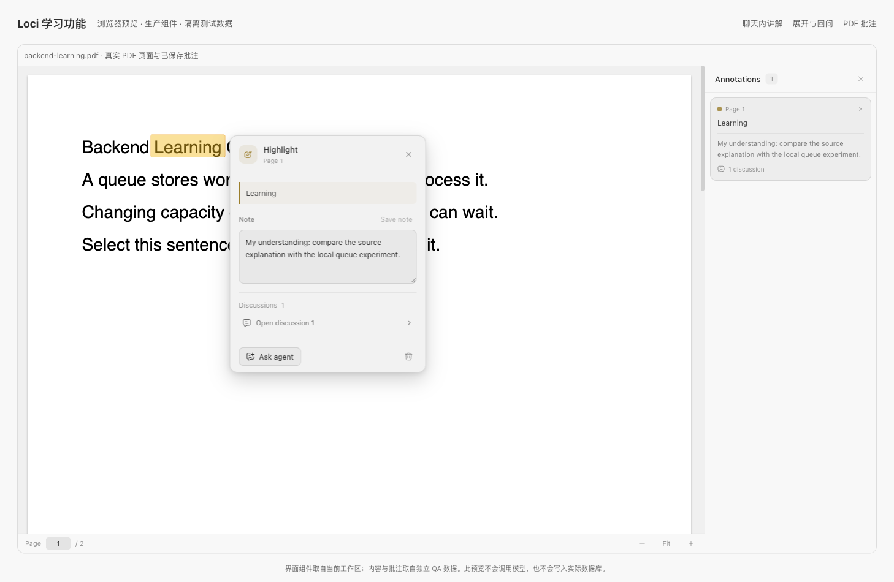

# 和导师一起阅读：来源提问、高亮与批注

Loci 的阅读区可以显示资料库文档、课程的课文、Markdown 与源码文件、PDF。所有阅读器共用同一套操作：选中文字后向导师提问、高亮、写笔记；导师知道你读到哪里；导师回复里的链接能跳回原文的具体位置。



## 选中文字

在任何阅读器里选中一段文字，会出现三个操作：

- **Ask <导师名>**：把选段连同它的位置作为来源放进导师的输入框，并预填 "Explain this passage."。这一步不会发送，可以先改问题再发。
- **Highlight**：保存黄色高亮。点击高亮会打开它：可以写笔记、提问、打开关联讨论或删除。
- **Note**：先高亮，再直接进入笔记输入框。

还有两个快捷键：**⌘L**（Windows/Linux 为 Ctrl+L）把选段作为引用放进输入框；**⌥⌘M**（Ctrl+Alt+M）打开评论框，写好后连同选段放进输入框。

不同阅读器里的位置信息：

| 阅读器 | 记录的位置 |
| --- | --- |
| 资料库文档、课程的文档课 | 选段原文、上下文、所在的小节标题 |
| 源码与文本文件（文件阅读器、课程的代码课） | 选段原文、行号（课程只显示部分行时，仍按文件原行号） |
| Markdown 文件预览 | 选段原文、所在小节 |
| PDF | 页码与选区矩形，新高亮同时保存原文 |

**Highlights & notes** 列出当前内容的全部高亮和笔记：文档在 "…" 菜单里；课程在课的菜单里（只列本课的部分）；文件阅读器和 PDF 在标题栏的笔形按钮。点击条目会滚动到原文并闪一下。

## 高亮如何跟随修改

高亮按文字定位，不按 DOM 位置：保存选段原文、前后各 32 个字符、所在小节和（文件中的）行号。文档被导师修订、文件被改了几行后，高亮仍落在同一段文字上；原文有多处相同文字时，按上下文选最贴合的一处；空白或大小写变了也能找到。文字已经不在时，高亮不会被删除，列表里会显示 "This passage changed"，可以继续提问或手动删除。

PDF 高亮保存每页的相对矩形，缩放时重新投影。PDF 依赖已有文本层，不做 OCR；没有可选文字的页面无法选段。

## 导师知道你读到哪里

每次发消息时，导师都会收到 `<reading_now>`：当前打开的课、文档或文件，以及 `place`：

- `section`：可见段落上方的小节标题（最多三级）
- `paragraph`：阅读区顶部那一段的开头（最多 280 字符）
- `page` 或 `lines`：PDF 当前页，或文件可见的行
- `selection`：你在阅读区选中的文字（最多 600 字符）。焦点移到输入框后仍然保留；在阅读区点一下或换页会清除。

所以 "这段" "这里" 不需要再解释。整个 `place` 不超过 1.5 KB；如果选段已经作为来源附在消息里，只写 `"selection":"attached"`，不会重复。

## 导师的引用会跳到原文

导师可以用 `loci://source/<id>` 引用来源，并带上位置：

```text
[Pod phase](loci://source/k8s-pod-lifecycle#section=Pod%20phase)
[Pending 的定义](loci://source/k8s-pod-lifecycle#section=Pod%20phase&quote=The%20Pod%20has%20been%20accepted)
[第 7 页](loci://source/<id>#p7)    [第 12–40 行](loci://source/<id>#L12-40)
```

`<id>` 是资料库里的文档 ID，或是消息里附带的来源 ID。点击后来源在阅读区打开（如果当前正读的课就是这篇文档，则留在课里，必要时展开全文），滚动到引用的文字并闪一下。文字已经改动时，显示所在小节并提示 "That passage has changed"。完整格式写在 `loci app --help` 的 "Citing what the learner reads" 一节。

## 课程目录里的数量

左栏课程目录在每一课后面显示这一课的高亮数量；有笔记时数字旁多一个小圆点。课程行显示总数。没有高亮时不显示。

## 网页与会话来源

输入框的附件菜单提供 **Web source**：填入 HTTP 或 HTTPS 地址、可选标题，再粘贴要讨论的原文。这里不自动抓取网页，点击来源会在系统浏览器中打开地址。聊天选段可以记录对应会话和消息。

来源在输入框和已发送消息中单独显示：点击标签右侧箭头（**Show passage**）查看选段，点击标题打开原处，移除标签可将它排除出下一次请求。

各 CLI 接收统一的文本上下文 `<loci_learning_context>`，无需 provider 专用的 UI 工具。只带入被引用的选段与相关上下文，不默认上传整本 PDF 或整篇文档。

## 关联讨论

围绕某个高亮的问题实际发送后，高亮才关联这条会话消息；准备或取消草稿不会创建关联。删除高亮会保留此前消息中的选段快照；会话已删除时，打开对应讨论会提示不可用。

## 命令行

`loci annotations list | counts | add | note | delete` 读写高亮和笔记，详见 [cli.md](cli.md)。导师在自己的对话里可以 `list` 和 `counts`，看到你标记了什么；新增、改笔记、删除只能从终端做。`loci reader open --source <id> --quote "<原文>"` 打开并闪烁一段原文。

## 存储

高亮、笔记和来源保存在本地 `loci.db`，不写回文件或 PDF。`learning_sources` 保存来源；`reading_documents` 保存 PDF 的规范化路径和 PDF.js 指纹；`pdf_annotations` 保存所有阅读器的高亮（v0.3 原地增加了 `target_kind`、`target_key`、`anchor_json` 三列，旧版本只看到其中的 PDF 高亮）。

PDF 移动后，**Locate file** 通过系统选择器重新定位；指纹不匹配时拒绝迁移，避免把旧高亮套到另一版文档上。

代码在 `src/features/learning`（模型、阅读器共用的界面）、`src/features/mentor/ui/useReadingPlace.ts`（阅读位置）和 `src-tauri/src/learning.rs`。
