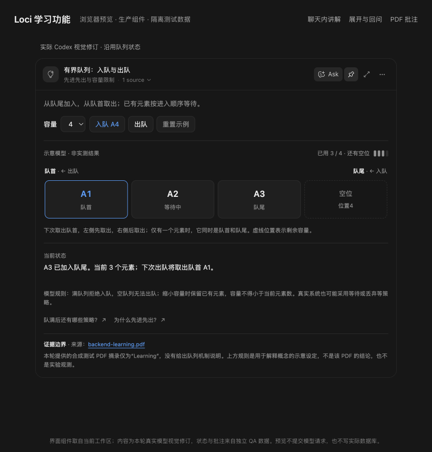
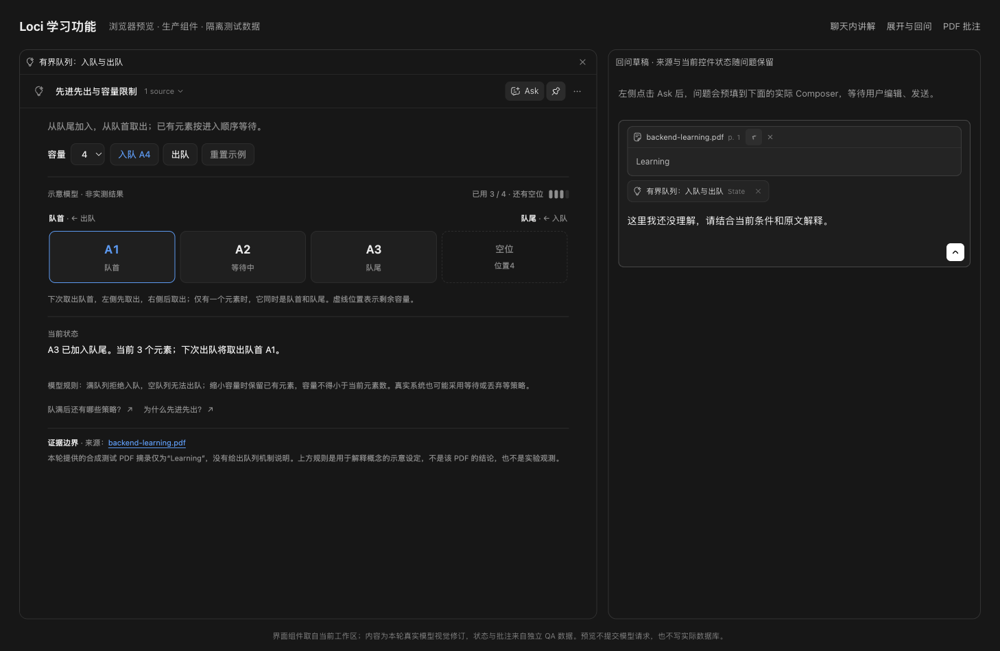

# 交互讲解与 PDF 批注使用说明

读后端技术文档、源码或电子书时，可以把不懂的片段交给 agent，让它用文字、图和可操作的示例解释。讲解直接出现在聊天里，也能展开到工作区继续研究；值得保留的内容再存入作品库，整理成画布或文章。

这条使用路径对应 [Waza `learn` 的学习方法](https://github.com/tw93/Waza/blob/main/skills/learn/SKILL.md)：从一手材料建立理解，结合实验验证，再用总结和写作检查自己的解释。终端实验仍由现有 agent CLI 或外部终端完成。

## 这次实现了什么

| 功能 | 现在可以做什么 |
| --- | --- |
| 生成式讲解 | 所有会话都能生成 `loci-widget`，用 HTML、CSS、JavaScript 和 SVG 组织调用过程、机制对比或交互示例。按钮和参数调整在界面内完成。 |
| 带来源提问 | 原文选段、文件行号、PDF 页码、网页地址和聊天消息可以作为来源附在问题上；草稿、排队、编辑重发和保存消息保留这些信息。 |
| 展开与继续讨论 | 聊天内和展开后的作品共享交互状态。追问带上当前条件、选中文字和来源，回到作品所属的会话。 |
| 手动保留作品 | 保留后的讲解进入所属 agent 或会话的作品库，可以重开、继续操作和修订。 |
| PDF 高亮与批注 | 选中文本保存黄色高亮和笔记，围绕高亮提问，并在原文与对应讨论之间返回。批注保存在 Loci，原 PDF 不变。 |

## 实际效果与截图

2026 年 10 月 10 日，在隔离的 macOS QA 应用中完成了原生验收，并使用真实 Codex GPT-6.1-Sol 生成中文有界队列讲解。实际操作包括入队、展开、追问、来源回跳、保留作品和重开恢复。

以下截图是**真实生产组件的浏览器预览**，使用本轮 Codex 实际生成的视觉修订、原有队列状态和合成测试 PDF。修订沿用作品 ID、来源与状态键，记录在隔离预览数据中。预览页组合展示应用现有的作品卡片、展开面板、输入框和 PDF 批注组件，为浏览器提供 Tauri 接口与自定义协议适配。此前原生验收结果与本轮界面预览分别说明。

本轮界面参考 Loci 已有的文档卡片、agent 面板和输入框：用中性色、细分隔线和紧凑字级组织内容，常驻操作收敛为追问、保留、展开与更多菜单。来源缩成一行，原文按需展开；PDF 批注使用主题实色底，分开原文、笔记和讨论。

### 在聊天内操作，展开后继续使用

模型生成的队列示例包含容量选择、入队、出队和当前状态解释。验收时容量为 4，入队后显示 3 个元素；展开视图继续使用同一状态。



同一份内容也能继承浅色主题：[查看浅色效果](images/learning/interactive-explanation-light.png)。

队列规则由模型作为示意设定生成，界面明确标注“非实测结果”。测试 PDF 的引用只有单词“Learning”，没有提供队列机制的依据；模型也在作品中说明了这一点。

### 带着当前条件追问

点击作品里的追问按钮后，问题进入输入框，并附上作品和来源。用户可以改写问题、移除来源，确认后再发送。单纯切换步骤、调整参数不会运行模型。



实际验收中，展开后的队列按钮能把问题送回原项目会话；从 Tutor 的 Library 重开作品后，追问进入 Tutor 当前会话。后者使用已生成作品的副本验证路由，不表示 Tutor 在本轮重新生成了该作品。

### 把 PDF 高亮与自己的理解放在一起

真实两页测试 PDF 可以选择文字、保存高亮、编辑笔记。来源入口返回高亮位置，批注中的讨论入口返回已发送的问题。原生应用重开后，高亮和笔记仍在。


## 使用交互讲解

可以先附上材料，也可以直接要求 agent 生成交互讲解。例如：

> 请结合这段源码解释请求经过哪些阶段。用可以逐步推进的图展示中间状态，说明每一步的条件，并保留原文来源。

agent 按问题选择文字、图或 `loci-widget`。界面上的按钮目前仍使用英文，下面保留原名以便查找。

| 操作 | 行为 |
| --- | --- |
| 展开图标（**Expand**） | 在工作区打开讲解。已有该作品的面板则聚焦它，否则在对话旁边打开。 |
| **Ask** | 把追问放入作品所属会话的输入框，携带当前状态、适用时的选中文字和来源。点击 **Send** 才运行 agent。 |
| 来源数量旁的箭头（**Sources**） | 显示作品引用的来源，点击来源后打开对应材料。 |
| 更多菜单 → **HTML** | 查看模型生成的代码。 |
| 图钉（**Keep in Library**） | 手动保留作品及当前状态。 |
| 已选中的图钉（**Saved · Remove**） | 从已保留列表移除作品，聊天中的原始内容仍在。 |
| 更多菜单 → **Prepare canvas / Prepare article** | 准备整理成 Excalidraw 画布或文章的请求，发送后再由 agent 完成。不会立即创建或发布内容。 |
| **Prepare fix** | 格式或运行错误时，准备修正请求，保留错误及相关内容。仍需用户发送，不自动反复重试。 |

常驻 agent 的已保留讲解在 **Details → Library**；普通项目会话的已保留讲解在聊天上方的 **Saved explanations**。完成的作品即使没有保留，也可以从聊天重看。只有已保留作品的后续操作状态会写入数据库；其他临时操作状态不会跨应用重启保留。

继续讨论时可以要求修改同一份讲解，例如“把失败分支也画出来”。同一作用域内，稳定 `id` 标识同一作品；修订更新 HTML，保留其保存状态与交互状态。新代码需要正确解释已有状态。发送作品追问前，Loci 会读取当前保存的 HTML、标题和版本，帮助 agent 在较早的模型上下文已经轮换后继续修改。

## 附上来源

输入框的附件菜单提供 **Web source**。填入 HTTP 或 HTTPS 地址、可选标题，再粘贴要讨论的原文。这里不自动抓取网页；点击来源会在系统浏览器中打开地址。

选中本地源码或文档后，可以使用 **Ask agent** 或已有的 **Add to chat**。代码选段记录文件与行范围；PDF 选段记录文档和页锚点；聊天选段可记录对应会话和消息。来源在输入框和已发送消息中单独显示，点击标签右侧箭头（**Show passage**）查看选段，点击标题打开原处，移除标签可将它排除出下一次请求。

来源标签支持打开、展开原文和移除。网页字段在添加前可以编辑；已添加内容需要修改时，可以移除后重新添加。

各 CLI 接收统一的文本上下文 `<loci_learning_context>`，无需 provider 专用的 UI 工具。原文和界面状态作为讨论依据，agent 应区分材料中的说法、自己的推导和实验观察。只带入被引用的选段与相关上下文，不默认上传整本 PDF。

agent 可以用 `[标题](loci://source/<id>)` 引用已登记来源。作品在 `sources` 头部声明这些 ID，再通过 `openSource` 请求宿主打开；这个接口不接受任意本地路径或无关 URL。

## 阅读和批注 PDF

从 **File → Open PDF…** 打开本地 PDF，也可以使用项目文件或会话附件的现有入口。PDF 不必放在仓库里。没有关联会话时，发问会要求选择已有 agent 或项目会话。

选中文字后有两种操作：

- **Ask agent**，把选段和位置放入问题草稿。这一步不会创建高亮，也不会启动模型。
- **Highlight**，保存黄色高亮。点击高亮可编辑笔记、提问、打开关联讨论或删除标记。面板工具栏的 **PDF annotations** 打开批注列表。

高亮不阻挡原生文字选择。选段可以跨行、跨页，矩形按每页的相对位置保存，缩放时重新投影。来源链接返回对应页；已保存高亮的链接会定位到具体片段。

围绕高亮的问题实际发送后，批注才关联这条会话消息。准备或取消草稿不会创建讨论链接。删除高亮保留此前消息中的选段快照；会话已删除时，打开对应讨论会显示不可用提示。

批注保存在本地 `loci.db`，不写回 PDF。文档记录使用规范化文件路径和 PDF.js 指纹。文件移动后，**Locate file** 可以通过系统选择器重新定位；指纹不匹配时拒绝迁移，避免把旧高亮套到另一版文档上。

当前依赖 PDF 已有的文本层，不执行 OCR。没有可选文字的页面会显示提示，需要文字版本才能选段提问或高亮。

## 生成 `loci-widget`

作品使用 fenced block。头部每行一个字段，之后为 HTML；`id` 和 `title` 必填，`subject` 和 `sources` 可选，不解析嵌套 YAML。

````text
```loci-widget
---
id: execution-trace
title: 跟踪一次执行过程
subject: 并发
sources: []
---
<style>
  .controls { display: flex; gap: 8px; margin-top: 12px; }
  button { padding: 6px 12px; border: 1px solid var(--loci-border);
    border-radius: 8px; background: var(--loci-background); color: var(--loci-text); }
</style>
<p id="trace"></p>
<div class="controls">
  <button id="next">下一步</button>
  <button id="ask">追问这一步</button>
</div>
<script>
  const steps = ["发送方开始。", "接收方准备完成。", "数据已传递。"];
  let step = 0;
  function render(state) {
    step = Number.isInteger(state?.step) ? Math.max(0, Math.min(2, state.step)) : 0;
    document.getElementById("trace").textContent = steps[step];
  }
  render(window.loci.getState());
  window.loci.onState(render);
  document.getElementById("next").onclick = () => window.loci.setState({ step: (step + 1) % steps.length });
  document.getElementById("ask").onclick = () => window.loci.ask("请详细解释当前这一步。");
</script>
```
````

`id` 最多 80 个字母、数字、下划线或连字符，修订同一作品时保持不变。标题最多 200 个字符。`sources` 接受已登记来源 ID 的 JSON 数组或逗号分隔列表，使用请求中提供的实际 ID。上面的例子没有来源，只演示界面交互，不代表某个具体协议的实际运行过程。

支持内联 HTML、CSS、原生 JavaScript、SVG 和 canvas，也接受完整 HTML 文档。宿主会在自己的文档内放入生成内容，并先初始化运行接口。当前没有 React/TSX 编译器、包解析器、外部脚本或 CDN；网络请求被阻止。图片使用 data URL，图形可用 SVG 或 canvas 绘制。显示一个实验结果不等于实际执行了终端命令。

宿主提供主题变量 `--loci-background`、`--loci-text`、`--loci-muted`、`--loci-accent`、`--loci-border` 和 `--loci-surface`，以及字体变量 `--loci-font`、`--loci-mono`。背景、文字、强调色和字体继承应用当前设置；主题与字体变化时会更新这些变量，保留交互状态。

生成规则要求优先使用宿主默认的文字与控件样式，让图形模型占据主要空间，减少装饰性底色、大标题和重复工具栏。已有作品若在自己的 CSS 中写死颜色或字体，需要请求 agent 修订才能统一风格；应用不会覆盖它们的全部自定义样式。

| API | 行为 |
| --- | --- |
| `window.loci.getState()` | 返回当前状态的 JSON 副本。 |
| `window.loci.setState(fullJson)` | 替换完整状态并通知监听函数，不调用 agent。状态必须可 JSON 序列化，最大 64 KiB。 |
| `window.loci.onState(fn)` | 状态变化时调用 `fn(state)`，返回取消监听函数。初始值通过 `getState()` 读取。 |
| `window.loci.ask(text)` | 在所属会话中准备追问，携带状态、来源，以及最多 2,000 个字符的当前选中文字，不自动发送。 |
| `window.loci.openSource(sourceId)` | 请求打开作品头部声明的已登记来源，由宿主解析目的地。 |
| `window.loci.resize(height)` | 建议聊天内高度，单位为像素，宿主限制在 160 至 1,000。内容高度也会自动测量。 |
| `window.loci.theme` | 当前主题，值为 `"light"` 或 `"dark"`。 |
| `window.loci.onTheme(fn)` | 主题变化时调用 `fn(theme)`，返回取消监听函数。 |

步骤、参数和选择等有意义的状态需要通过 `setState` 保存。只存在 DOM 中的状态不会在内联与展开视图之间同步。会话选择、来源导航、保留作品和模型提交由宿主处理。

## 运行与存储

`WidgetFrame` 打开固定的 `loci-widget://localhost/proxy.html` 页面；Windows 使用 `http://loci-widget.localhost/proxy.html`。Rust 只提供这个静态资源。可信代理创建第二层 `about:srcdoc` iframe 来运行生成内容，两层都使用 `sandbox="allow-scripts"`，不授予 `allow-same-origin`。

主应用保持 `script-src 'self'`。代理页面使用独立的 CSP，允许内联代码，阻止网络连接、外部脚本、通过 URL 加载的 frame、对象、表单提交和基准 URL 修改。内层文档继承这些限制，并增加自己的 CSP。宿主与代理通过 `MessageChannel` 通信，内层消息核对发送窗口；宿主只接受高度、JSON 状态、问题草稿和已声明来源，不向作品提供 Tauri invoke 或工具执行接口。

`src/features/learning` 包含渲染、交互桥、来源、批注和生成规则；`src-tauri/src/learning.rs` 管理来源、文档、批注和作品表。作品按所属类型、所属 ID 和作品 ID 区分，修订记录来源会话和消息。PDF 批注和来源记录独立于作品的保留状态。

## 已完成的验收与当前边界

本次交付日志记录：**344 个 Web 测试文件、3,877 项 Web 测试和 240 项 Rust 测试通过**，TypeScript、格式检查与 Clippy 通过，macOS 应用构建成功。数字对应 2026 年 10 月 10 日的验收版本，不表示以后新增代码仍有相同测试数量。

后续界面精修通过 `npm run check:web`：349 个文件、3,929 项测试及 TypeScript 检查通过，生产构建与 macOS 应用打包成功。浏览器组件预览另检查深浅主题、360px 卡片、更多菜单、来源展开和带状态追问。本轮截图工具未能可靠操作双层沙箱内的入队、出队按钮，因此这两项没有记录为本轮浏览器验收通过；此前原生操作结果见下方。当前工作区还有其他并行改动，测试总数包含这些已有代码。

原生验收已确认以下行为：

- 自定义协议加载 HTML/JS，生成内容无法读取父窗口、联网或使用原生接口。
- 聊天内操作与展开视图状态同步，追问先成为所属会话的草稿。
- 手动保留的作品可以重开，应用重启后恢复保存的状态。
- 真实两页 PDF 的文字选择、高亮、笔记编辑、来源回跳和讨论回跳可用，重启后恢复。
- 真实 Codex 生成中文队列作品，界面能入队并解释当前状态，来源链接可返回 PDF 高亮。
- Tutor 的 Library 能重开已保留作品，并把追问交给 Tutor 当前会话。

跨页选段、缩放几何、主题消息、文件迁移、不同指纹拒绝、旧版本回退和修复草稿另有自动测试。PDF UI 测试使用模拟 PDF.js worker；这些测试不替代对应场景的原生验收。原生操作本次覆盖 macOS，尚未逐一验证 Windows、Linux 和所有 CLI。

讲解内容仍由所选模型生成，需要核对来源、模型假设和实际实验结果。作品本身不运行终端命令，不自动发布文章，也不包含 OCR、React/TSX 或外部依赖加载。
