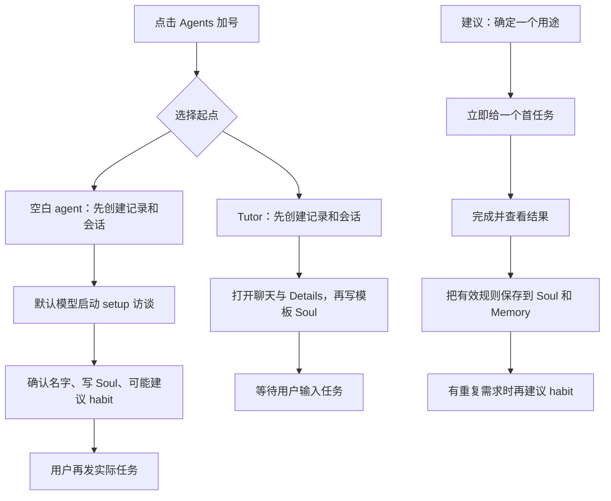

# Personal agent 创建与使用体验记录

记录日期：2026-10-10。以下为改进前的体验记录，后续已实施的功能变化见末尾“功能改进落实”。对象：Loci 当前工作区构建出的原生 release 应用，隔离测试标识为 `com.loci.agent-qa-20261010`。初次体验经过了创建、切换模型、聊天设定角色、保存 Soul 和 Memory、完成首任务、打开 Library 文档、保存为笔记。

当前版本已删除全部内置 agent 模板，新建统一打开空白 agent。下文保留当时的模板体验记录；已有 agent 的 Soul、Memory 和对话仍然保留。

长期对话、记忆和文档库已经能组成一条有用的学习助手工作流，重启后也能继续。首次创建的恢复能力和聊天结果的可见性仍有问题：停止初始化后会显示完成，用户需要自己补发设置；已经完成的 GPT 回复在聊天区不可见的情况重复出现。创建流程应先解决这些可靠性问题，再缩短从确定用途到完成首任务的路径。

代码模板只保留 Tutor，删除 Lead、Watch、Reviewer、Scout、Chief 五个内置模板。重建并重开原生应用后，新建菜单实际只剩 Blank 和 Tutor。现有 agent 全部保留。模板清理只涉及新建时的起点，不代表删除已有角色、对话、Soul 或 Memory。来源：当时的 `agentTemplates.ts`（现已删除）。初次体验阶段只分析创建流程；随后按用户要求直接实施功能改进。

## 证据范围

| 类型 | 本轮证据 | 能说明什么 |
| --- | --- | --- |
| 原生实测 | 真实原生应用、真实 Claude / Codex provider、界面操作和持久化结果 | 本次用户路径实际发生的行为，不代表所有模型和机器的稳定表现 |
| Mock 确定性验证 | 生产 `useAgents` hook 和 question parser，替换文件、provider、持久化等边界；五个探针及两项现有定向测试全部通过 | 特定时序或输入下的控制流，可重现代码问题；不等同于真实 provider 或原生渲染验收 |
| 静态事实 | 当前创建 hook、setup prompt、详情页、模板和预览代码 | 产品目前要求的步骤及状态处理，不证明用户一定遇到相应问题 |
| 推断 | 根据以上事实提出的体验风险和建议 | 需要继续验证，不能当成已确认根因 |

原生证据保存在本地 [native-qa-evidence.json](../output/agent-experience/native-qa-evidence.json)，包括过滤掉工具块的会话、生成文档和保存的笔记。另有 [SOUL.md 快照](../output/agent-experience/b82d923f-9eb5-44be-a1f1-568a37621c60/SOUL.md)和 [MEMORY.md 快照](../output/agent-experience/b82d923f-9eb5-44be-a1f1-568a37621c60/MEMORY.md)。控制流探针见本地 [creationFlow.probe.test.ts](../output/creation-flow-audit/creationFlow.probe.test.ts)及其 [Vitest 配置](../output/creation-flow-audit/vitest.probe.config.ts)。这些 `output/` 文件是本轮本地证据，不是发布依赖。

## 实际用户路径

| 步骤 | 操作与结果 | 评价及限制 |
| --- | --- | --- |
| 创建空白 agent | 默认 Claude 初始化约 49 秒没有正文，随后因用户要求 GPT 而人为停止 | 尚未到超时，原因未确定。这是路径中的观察，不能据此认定产品性能故障 |
| 停止初始化 | 界面显示 `Completed 49s` 和 `Work complete`；没有完成角色设定，也没有直接继续初始化 | 完成状态与任务结果不一致，恢复路径不清楚 |
| 换模型并确定角色 | 在 Details 改为 Codex / GPT-6.1-Sol / Low，手动发消息确定“小序”，角色为学习计划助手 | 能在现有 agent 内继续，无需重新创建；但这次是用户自己补写了设置消息 |
| 保存长期规则 | 保存中文、简洁、最多三项行动、每项写时间、先给结果等 Soul 规则，用户同时明确不创建定时任务、不关联项目、不操作外部应用或发送消息 | 真实 provider 成功保存 Soul；该轮界面显示约 22 秒，持久化 `durationMs` 为 22020 |
| 保存学习偏好 | 记住每天只有 30 分钟、喜欢先练习后解释，在 Details → Memory 查看确认 | 聊天到长期记忆的路径成立，文件快照也有对应记录 |
| 完成首任务 | 请求《HTTP 缓存：第一次练习》，按 0~12、12~22、22~30 分钟安排三项行动，先练习再解释，并生成文档卡 | 实际产物遵循已保存的偏好；该轮约 17 秒，持久化 `durationMs` 为 16891 |
| 阅读和保留结果 | 从聊天文档卡打开学习单，执行 Save as note，界面显示 `Saved to Notes`；重启后在 Details → Library 找到并重新打开同一文档，存储中有同标题笔记 | 文档生成、查看、文档库恢复和另存为笔记已连通 |
| 回看聊天 | 首次 GPT 设置完成后，侧栏预览已有内容，聊天正文却为空；静置数分钟未恢复。向上滚动或 Jump to latest 后部分恢复，再向下滚动一次才完整显示 | 有产物不等于用户立即看得到产物；这里的可见性问题需要单独定位 |
| 重启后续聊 | 重建并重开 QA 应用，小序身份、对话和文档卡保留；续聊约 9 秒正确回答“我叫小序。你每天 30 分钟，先练习后解释” | 长期身份和记忆经过重启验证；但此时两个聊天窗格再次空白，预览、AX 元数据和保存结果仍有内容 |
| 以 GPT 再建空白 agent | 将默认设为 Codex / GPT 后，新 agent 约 16 秒出现主要职责问题，有五个选项和自定义输入；一次完整自定义回答确定“图钉”和行动清单助手角色，约 17 秒完成改名、Soul 保存及确认 | 当前并不强制两三轮访谈，完整回答可跳过分步提问；新建旁边分栏并自动展开 Details 后，新聊天过窄，名称和提示截断 |
| 图钉的首任务 | 约 6 秒生成 20 分钟桌面整理 `loci-todo` 卡，三项行动分别为 2、5、13 分钟，符合 Soul；勾选第一项后自动发出 `Done: 选书`。约 6 秒后模型回传同一清单，第一项 checked，进度 1/3，剩余 5 分钟清桌和 13 分钟读书 | 卡片交互与模型跟进成立；但正文和卡再次空白，向下滚动无效，向上滚动、Jump to latest、再向下滚动才出现三个 checkbox。模型和数据正常，实际可读交付经过滚动补救才完成 |
| 两个 agent 并行工作 | Working agents 中两张卡均名为 `New agent`，详情显露完整 shell 路径和 JSON；一次仅问记忆的当前请求仍显示历史 `memory.add` | 身份及活动摘要有噪声，尚未追到根因，不能据此认定重复执行了历史操作 |

首轮设置的 22 秒和学习任务的 17 秒来自本次原生 UI 与持久化 duration，后续 6、9、16、17 秒为单次界面观察，都不是多次采样统计。49 秒包含被人为停止的初始化，不用于与其他模型或竞品比较速度。

## 问题记录与最小建议

优先级按用户影响划分：P1 会阻断首次使用或让用户误判任务状态；P2 是可重现的初始化边界问题或明显流程摩擦；P3 影响预览、命名或文案。没有确认数据丢失或权限越界，因此不列 P0，也不将默认权限模式本身列为缺陷。

| 编号 / 优先级 | 问题 | 证据与确认范围 | 最小建议 |
| --- | --- | --- | --- |
| A01 / P1 | 手动 Stop 后仍显示完成，未完成的创建缺少继续入口 | **原生实测**：Claude setup 被停止后显示 `Completed 49s` / `Work complete`，后续由用户手动补写角色和规则。**已定位原因**：`stop` 先使旧 turn 事件失效，再通过 `stopStreaming` 封流和置 `busy:false`，没有写入中断 notice；渲染层将没有 error / interrupt 的已结束 turn 默认显示为完成。调用者得到的 `cancelled` 没有进入 transcript。来源：[useSessionSubmission.ts](../src/app/hooks/useSessionSubmission.ts)（1133、1140 行）、[apply.ts](../src/integrations/harness/core/apply.ts)（510 行）、[AgentTranscript.tsx](../src/features/sessions/ui/AgentTranscript.tsx)（750、787 行） | Stop 在本地保存明确终态，状态行与耗时文案共同读取它；未完成 setup 给出继续设置入口，换模型后可复用原设置消息 |
| A02 / P1 | GPT 已完成的回复在聊天区不可见，需滚动补救 | **原生实测，重复发生**：预览有回复，正文为空，首次经滚动才完整出现；重启续聊后两个窗格再次空白。图钉首任务的已保存 todo 卡也只在向上滚动、Jump to latest、再向下滚动后出现。AX 元数据和保存结果仍正确。**源码反证**：最新 turn 完成后仍有 `transcript-turn-live`，CSS 强制 `content-visibility:visible`，所以不能直接归因于历史 turn 的 240px 占位。根因尚未确定。来源：[AgentTranscript.tsx](../src/features/sessions/ui/AgentTranscript.tsx)（919 行）、[index.css](../src/styles/index.css)（581、638 行） | 对比空白、Jump 后、真实滚动后的正文 DOM、几何、透明度和 scroll 状态，区分布局/绘制失效与正文 reveal 未完成。验收标准是完成回复和卡片立即可读，不依赖手动滚动 |
| A03 / P1 | 会话创建等待期间关闭视图，会留下未初始化的记录 | **Mock 确定性验证，两个探针**：延迟 `homeDir`，在完成前执行 `agents.close()`。roster 和 session 已存在，但请求 token 变化使后续返回；模板 Soul 未写入，空白 setup 未发送。重新打开只显示已有 session，不补初始化。来源：[useAgents.ts](../src/app/hooks/useAgents.ts)、[探针脚本](../output/creation-flow-audit/creationFlow.probe.test.ts) | 将初始化完成与是否打开面板分开。取消展示可以不打断已创建 agent 的初始化；中断或失败要保留可恢复状态 |
| A04 / P2 | 模板 agent 在 Soul 写入前就打开聊天和 Details | **Mock 确定性验证**：让 `loadAgentFiles` 保持 pending，`onShow` 已执行，Details 已打开，Soul 尚未保存。首次消息读取到默认 Soul 是时序风险，本轮未在真实 provider 中复现。来源：[useAgents.ts](../src/app/hooks/useAgents.ts)、[探针脚本](../output/creation-flow-audit/creationFlow.probe.test.ts) | 模板 Soul 写完后再允许首次提交，或给出短暂的初始化状态。避免把可交互的界面当成初始化已完成 |
| A05 / P2 | 空白 setup 提交返回 `false` 时，创建 hook 不处理结果 | **Mock 确定性验证**：`submission.submit` 返回 `false`，`useAgents` 的 `onError` 未调用；agent 和 session 保留，重新打开不重试。这里只确认创建 hook 没处理返回值，不推断 submission 内部没有任何错误提示。来源：[useAgents.ts](../src/app/hooks/useAgents.ts)、[探针脚本](../output/creation-flow-audit/creationFlow.probe.test.ts) | 将“记录已创建”和“设置消息已接受”区分开；未接受时显示可重试状态，不让 agent 静默停在未设定阶段 |
| A06 / P2 | 无效 question JSON 会被隐藏，也不会出现问题表单 | **Mock 确定性验证**：带尾逗号的 `loci-question` 解析为零个问题，但 `stripQuestionBlock` 仍删除原文，用户只能看到不完整的引导句。不是本轮原生首次 setup 已发生的事实。来源：[standingQuestion.ts](../src/features/sessions/model/standingQuestion.ts)、[探针脚本](../output/creation-flow-audit/creationFlow.probe.test.ts) | 仅隐藏成功解析的 question block。无效时保留可读内容或明确降级为文字提问，避免下一步从界面上消失 |
| A07 / P2 | 空白与模板的首次体验不一致 | **静态事实**：空白入口自动发 `New agent`，prompt 建议两三问，确认名字、写 Soul 后停止；模板入口只写 Soul，等待用户先说话。**原生反证**：图钉用一次完整自定义回答完成设定，并不强制多轮。来源：[useAgents.ts](../src/app/hooks/useAgents.ts)、[agentFiles.ts](../src/features/agents/model/agentFiles.ts)、[AgentIntro.tsx](../src/features/agents/ui/AgentIntro.tsx)。模板用户不知道该输入什么仍是推断 | 保留一个清楚的创建入口；两种起点都直接说明能做的首任务，并允许立刻开始，继续支持一次回答确定完整规则 |
| A08 / P2 | 新建自动分栏并展开 Details，使新聊天过窄 | **原生实测**：新图钉聊天在小序旁分栏，同时自动打开 Details，名称和提示在截图中截断。**静态事实**：创建时调用 `setDetailsOpenFor(agent.id, true)`。来源：[useAgents.ts](../src/app/hooks/useAgents.ts)、[AgentDetails.tsx](../src/features/agents/ui/AgentDetails.tsx)。多处设置导致重心分散是进一步推断 | 创建后聚焦新 agent，Details 可后置或保障聊天最小可读宽度；保留产品支持多窗格的能力，避免布局妨碍首轮回答 |
| A09 / P2 | 首次开场对定时工作的运行条件不够明确 | **静态事实**：setup 开场要求介绍自主定时能力，没有要求同时说明“仅 Loci 打开时”；实际 agent context 和 Habits 页面有此限制。**推断**：新用户可能以为关闭应用后仍运行，本轮没有创建或执行 habit。来源：[agentFiles.ts](../src/features/agents/model/agentFiles.ts)、[AgentDetails.tsx](../src/features/agents/ui/AgentDetails.tsx)、[useAgentHabits.ts](../src/app/hooks/useAgentHabits.ts) | 首次提到 habit 时就补充运行条件；等一次任务成功并明确需要重复时，再建议创建 habit |
| A10 / P3 | 侧栏预览混入文档卡中的 HTTP 代码 | **原生实测**：文档和笔记保存正确，但 agent preview 带入文档内容，摘要较嘈杂。预览目前独立清理 Markdown 和代码 fence。来源：[agentPreview.ts](../src/features/agents/model/agentPreview.ts) | 对文档卡使用标题或完成摘要，不把正文内嵌代码当成最后一句回复。先保留能够判断任务结果的短句 |
| A11 / P3 | 同一模板可生成多个同名 agent，后续不易区分 | **静态事实**：模板固定名为 Tutor，`createAgent` 接受该名字，没有按同名 roster 生成区别名；初始截图也有多个 Tutor，但不能仅凭截图断言它们都由同一入口创建。来源：当时的 `agentTemplates.ts`（现已删除）、[agent.ts](../src/features/agents/model/agent.ts) | 创建同类 agent 时默认给出可区别的名字或用途，并允许保留原名。模板减少到一个后仍需处理这个问题 |
| A12 / P2 | Working agents 没有用常驻身份区分工作，活动详情混入历史和执行文本 | **原生实测**：两个 agent 的卡片都叫 `New agent`，当前询问记忆时仍见历史 `memory.add`，详情有完整 shell 路径与 JSON。尚未确认是标题同步、活动筛选还是状态映射的问题，也未证实存在额外操作。来源：[liveAgents.ts](../src/features/sessions/model/liveAgents.ts)、[LiveAgentsPreview.tsx](../src/features/sessions/ui/LiveAgentsPreview.tsx) | 状态卡优先显示小序、图钉等常驻身份和当前请求摘要，历史活动与原始执行详情按需展开 |
| A13 / P2 | 登录完成的 Continue 没有恢复失败的初始化 | **静态事实**：登录对话框把 `onComplete` 绑定为 `onClose`，关闭后没有重发 setup；`open` 也只加载聊天。未执行真实重新登录，本轮不修改凭据。来源：[ProviderSignInDialog.tsx](../src/features/sessions/ui/ProviderSignInDialog.tsx)（53 行）、[useAgents.ts](../src/app/hooks/useAgents.ts)（196 行） | 登录完成后回到明确的继续设置动作，复用同一个 agent，避免要求用户自己重写隐藏的 setup |
| A14 / P2 | 文件读取失败时，Soul 和整个 agent 上下文一并静默缺失 | **静态事实及已有测试**：`loadAgentFiles` 失败被捕获为 `undefined`，随后不注入身份、Soul、记忆或应用/卡片规则；已有测试明确要求 provider 只收到原始 `Hello`。本轮未模拟真实磁盘故障。来源：[agentTurnContext.ts](../src/features/agents/model/agentTurnContext.ts)（52 行）、[useSessionSubmission.test.ts](../src/app/hooks/useSessionSubmission.test.ts)（693 行） | 区分可降级的记忆读取和必要的身份/Soul 读取；必要规则不可用时给出可恢复提示，避免把普通助手回应当成 personal agent 已就绪 |

还有两项低优先级观察，不计入已确认缺陷：文档卡显示 `86 words`，中文词数的估算方式可能不符合阅读直觉，但本轮没有定义准确计数标准；AX 文本中直接出现 `**第30秒：**` 等 Markdown 标记，尚未用截图核实视觉渲染，不能据此认定 parser 有问题。它们都不影响本次文档和笔记的存储结果。

## 当前流程与建议顺序

当前设计的优点是用户不用先填长表单，角色可以在聊天里形成，长期规则和记忆可由 agent 直接保存。代价是空白 agent 的第一步依赖模型成功回答，模板又走另一条没有开场任务的路径；应用没有明确表达“身份尚未确定”“初始化被停止”“初始化失败”的区别。

最小方向是统一首任务顺序，保留长期对话、记忆、CLI 和 local-first 的边界。用途可以来自一句自然语言，也可以来自 Tutor 起点；名字和外观允许稍后调整。已经说明用途的用户应能直接开始，必要问题在任务中补齐。用户已明确的规则直接保存，从首次任务中发现的偏好再固化，避免为设置顺序追加重复确认。

可靠性修复的验收应覆盖关闭或切换时初始化可恢复、模板第一轮读到正确 Soul、提交拒绝可重试、Stop 与完成可区分、完成结果立即可见、无效问题块仍有下一步。流程调整再比较确定用途前后的操作数和首任务完成率。上述建议尚未实施。

## 与 Grok Bot 的对照

对照对象是 xAI / Cursor 的独立 Grok Bot 产品。已经读取并通过浏览器核实当前官方文档，没有登录其应用或创建 Bot。因此这里比较官方描述的流程和机制，不比较实际耗时、模型质量、成功率或整体流畅度。

| 维度 | Grok Bot 官方描述 | 对 Loci 的启发与限制 |
| --- | --- | --- |
| 首次引导 | 介绍 Bots、共享电脑和 routines，询问常用工具以生成 teammate 建议；选建议或 Create your own，提供短名、一个主职能和工作描述，然后给首任务。[Get started](https://docs.x.ai/grok-bot/get-started) | 可以借鉴聚焦用途和首任务。Loci 不需要因此增加账号、云电脑或工具连接步骤 |
| 后续创建 | New → Create new Bot → 打开 New Bot → Edit Profile → 给具体任务，并非所有创建都只填三个字段。[Create and manage Bots](https://docs.x.ai/grok-bot/bots) | 不能据文档宣称 Grok Bot 一直比 Loci 步骤更少。应先统一 Loci 自己的两个入口 |
| 重复工作 | 官方建议先完成一次任务，可靠后保存为 skill，再创建 routine；提供 Test run 和近期运行记录。[Skills and routines](https://docs.x.ai/grok-bot/skills-routines-and-automations) | 习惯后置有直接可迁移价值，尤其是先确认输出是否适用，再决定是否重复运行 |
| 聊天协作 | 聊天展示工具活动、文件、问题和审批，工作进行中可发送新指令。[Message and collaborate](https://docs.x.ai/grok-bot/chat-and-collaboration) | Loci 本次完成结果不可见的问题会影响这类长期聊天的基本可信度；应先让当前聊天可靠 |
| 运行条件 | 所有 Bots 共用用户的持久云电脑，能在笔记本关闭后继续运行。[Grok Bot overview](https://x.ai/bot) | Loci 的 habits 只在应用打开时运行。两者执行环境不同，Loci 应明确自身条件，不沿用云运行预期 |
| 恢复复杂度 | 官方也描述电脑初始化可能需要数分钟，并提供 Retry、Recover、Update 等恢复路径。[Troubleshooting](https://docs.x.ai/grok-bot/troubleshooting) | 文档结构较完整不能证明真实体验没有摩擦，也不能把这次 Claude 的 49 秒等待与云初始化做速度排名 |

本轮未覆盖 habit 执行、项目关联、委派会话、长期会话轮换、不同系统或多用户样本。已验证的成果包括 GPT 空白创建中的可点选问题、一次回答完成身份设定、真实学习助手保存规则和偏好、重启后正确续聊、按偏好完成首任务、把文档保留在 Library 并另存为笔记，以及 todo 勾选自动回发消息后由模型保留完成进度。原生可见性和状态问题，以及五个确定性控制流探针，构成下一轮修复的具体依据。

## 初次体验检查结果

- 模板现有测试 4/4 通过，`tsc --noEmit` 与 `git diff --check` 通过。
- 创建与问题卡诊断探针 5/5 通过；定向执行文件读取失败和取消结果两项现有 submission 测试，2/2 通过，其余 37 项未在该命令中运行。
- 独立 QA 原生 release 构建成功；重新打开后实际菜单只有 Blank 和 Tutor。创建、Soul、Memory、文档库、笔记、续聊和清单勾选均使用真实 GPT provider 验证，聊天结果可见性需要滚动补救的情况如上记录。
- 初次体验阶段的改动只精简模板及其相关测试、英中文 README，并新增这份记录；当时尚未实施创建流程改进或显示修复。

## 功能改进落实

用户要求跳过可靠性修复，直接改进功能。本次落实的是创建与首任务路径，不把上面的可靠性建议作为前置条件：

- 空白和 Tutor 创建后都直接打开空聊天，Details 默认收起，不自动发送模型访谈。
- 首屏提供三个可编辑任务示例和模型选择；点示例只填草稿并聚焦，发送前可以修改。
- 首条消息直接做任务。明确长期用途或常驻规则时保存 Soul 和 role，保留当前名字；一次性任务不固化成长期角色。
- Tutor 从首课或练习开始，在教学中了解偏好，路线图后置。习惯只在完成任务且有明确重复需求时建议；用户主动要求排程仍可直接使用。
- 沿用当前独立 agent 工作区及既有 Soul 接口，没有新增创建状态字段或设置向导，没有迁移或改写已有 agent 的 Soul。

使用独立原生 QA 包、真实 Codex / GPT-6.1-Sol / Low 验证了三条路径：

| 路径 | 实际结果 |
| --- | --- |
| Blank → 点 Plan my day → 修改后发送 | 创建和点示例时保持 Idle。第一轮约 25 秒完成 45 分钟三步计划，同时保存中文、最多三步、每步给时间等长期规则，role 为“计划助手”，没有命名访谈或创建习惯 |
| Tutor → 首课示例 → 回答练习 | 创建时即显示主题示例与模型选择。第一轮约 25 秒直接给一道 HTTP 缓存选择题，未先采访偏好；选择答案后约 8 秒给出解释 |
| Blank → 直接发送一次性改写 | 约 16 秒返回改写句子。Details 中 Role 仍为空，Soul 仍是默认内容，没有把一次性改写定义成写作角色 |

34 项相关测试、类型检查、原生 release 构建及 `git diff --check` 通过。包含真实组件中的“示例预填 → 聚焦输入 → 修改 → Enter 提交”检查。原生证据见本地 [native-evidence.json](../output/agent-creation-improvement/native-evidence.json)。时间均为本次单次观察，不是性能基准。以上功能改动未提交。

## 再次改进：一句自然话语完成初始化

用户反馈仍不想填写表单。上一轮实测额外写了“长期规则”“不做访谈”，没有证明普通一句话能顺利开始；首屏的长示例和模型选择也继续把配置责任交给用户。这次删除这些创建控件，首屏只保留一句提示与现有聊天框，默认继承模型，设置按需打开。

参考依据是官方 [Grok Bot 101](https://x.ai/bot/guides/grok-bot-101)：Name、Title、Description 可以在聊天中设置。官方 [Grok Bot for Work](https://x.ai/bot/guides/grok-bot-for-work) 公开了按职责、来源、输出和边界组织的角色指令。没有找到可确认的完整 Grok Bot 底层系统提示词；[xai-org/grok-prompts](https://github.com/xai-org/grok-prompts) 明确面向 Grok Chat 与 X 上的 @grok。这次的自动初版生成是 Loci 的实现，公开资料只证明聊天可配置身份，不证明 Grok Bot 内部采用同样推导方法。

初始化规则现在是：

- 未分配角色且 Soul 仍是默认值时，“我想练英语口语”这样的自然用途表达足以生成简短角色和 3–5 条初版指令，同时开始有用的活动。
- 仅占位名字允许自动生成短名；用户选过的名字保留。显式命名标记加入上下文 hash，包括用户选择与占位名相同的名称这一情况。
- 自定义 Soul 不自动覆写，一次性改写等请求不固化成长期身份。初始化自身资料不授予外部操作或排程权限。
- 缺少直接阻止任务的信息才问一个关键问题，默认用自然对话。偏好可以边用边形成，不把所有问题都变成选择表单；有用的决策卡与课堂练习仍可使用。

真实原生 QA / Codex GPT-6.1-Sol Low 的这轮输入没有补任何配置规则：

| 输入 | 实际结果 |
| --- | --- |
| 我想练英语口语 | 一轮约 25 秒，自动命名 Echo、设定“英语口语练习伙伴”，保存四条 Soul；直接开始日常对话练习，未询问名字、水平、时长或偏好，也未出现初始化表单 |
| Today was busy. I goed to work and buyed a coffee. | 约 4 秒给出 went / bought 两处纠正，并自然继续对话，没有返回设置流程 |
| 把“明天开会讨论下计划”改成正式一点的一句话 | 约 8 秒直接返回改写；原空白 Moss 未改名、未生成长期角色，Soul 保持默认值 |

证据保存在本地 [native-evidence.json](../output/agent-natural-creation/native-evidence.json)，包含实际消息、档案和 Soul。相关测试、类型检查、QA 与主应用 release 构建及 diff 检查通过。主应用已重新构建并启动，原八个 agent 均保留；重启后的自动化窗口识别失败，后续主应用控件操作未能继续。上述核心流程是在独立原生 QA 中验证的。改动未提交，先前的可靠性问题未作为本轮修复范围。
